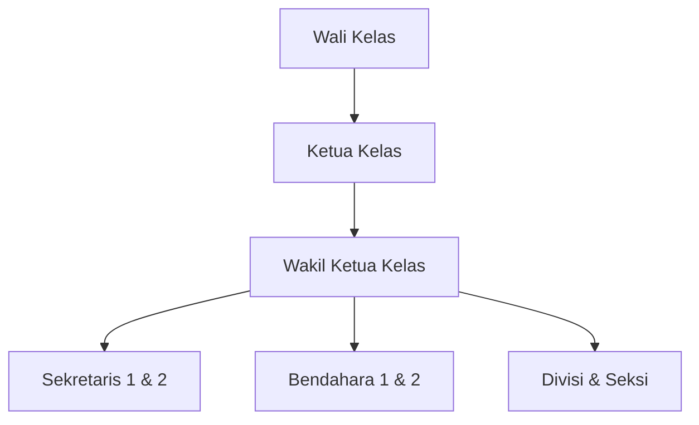

# README - Struktur & Profil Kelas XI TKJ 1

**SMK Telkom Malang** | *Tahun Ajaran 2025/2026*

---

## 📌 About Us

Selamat datang di repository resmi kelas **XI TKJ 1** (Eleven Network One) SMK Telkom Malang. Repository ini digunakan sebagai pusat informasi organisasi kelas, dokumen kegiatan, tata tertib, serta direktori tugas kelompok.

* **Program Keahlian:** Teknik Komputer dan Jaringan (TKJ)
* **Wali Kelas:** [Nama Wali Kelas, S.Kom.]
* **Slogan:** *"Connect the World, Master the Network"*

---

## 👥 Organizational Structure



### Executive Board

| Avatar | Role | Name | GitHub / Social |
| --- | --- | --- | --- |
| 🧑‍🏫 | **Wali Kelas** | [Nama Guru] | `@username` |
| 👑 | **Ketua Kelas** | [Nama Ketua] | `@username` |
| 🛡️ | **Wakil Ketua** | [Nama Wakil] | `@username` |
| 📝 | **Sekretaris 1** | [Nama Sekretaris 1] | `@username` |
| 📋 | **Sekretaris 2** | [Nama Sekretaris 2] | `@username` |
| 💰 | **Bendahara 1** | [Nama Bendahara 1] | `@username` |
| 💳 | **Bendahara 2** | [Nama Bendahara 2] | `@username` |

---

## 🧹 Roster & Cleaning Schedule

| Monday | Tuesday | Wednesday | Thursday | Friday |
| --- | --- | --- | --- | --- |
| 👤 [Siswa 1] | 👤 [Siswa 6] | 👤 [Siswa 11] | 👤 [Siswa 16] | 👤 [Siswa 21] |
| 👤 [Siswa 2] | 👤 [Siswa 7] | 👤 [Siswa 12] | 👤 [Siswa 17] | 👤 [Siswa 22] |
| 👤 [Siswa 3] | 👤 [Siswa 8] | 👤 [Siswa 13] | 👤 [Siswa 18] | 👤 [Siswa 23] |
| 👤 [Siswa 4] | 👤 [Siswa 9] | 👤 [Siswa 14] | 👤 [Siswa 19] | 👤 [Siswa 24] |
| 👤 [Siswa 5] | 👤 [Siswa 10] | 👤 [Siswa 15] | 👤 [Siswa 20] | 👤 [Siswa 25] |

---

## 📜 Rules & Regulations

> [!IMPORTANT]
> Seluruh anggota kelas wajib mematuhi aturan standar SMK Telkom Malang dan laboratorium komputer.

* [x] **Disciplined:** Hadir sebelum jam pelajaran dan tepat waktu saat jam lab.
* [x] **Cleanliness:** Menjaga kebersihan ruang kelas dan merapikan perangkat lab setelah praktik.
* [x] **Attire:** Menggunakan seragam lengkap sesuai ketentuan hari.
* [x] **Finance:** Membayar uang kas kelas sesuai tenggat waktu harian/mingguan.

---

## 📁 Repository Structure

```text
.
├── 📂 docs/               # Dokumentasi kegiatan & struktur organisasi
├── 📂 schedules/          # Jadwal pelajaran & piket harian
├── 📂 assignments/        # Tugas kelompok & materi bersama
└── README.md              # Profil utama kelas XI TKJ 1

```

---
